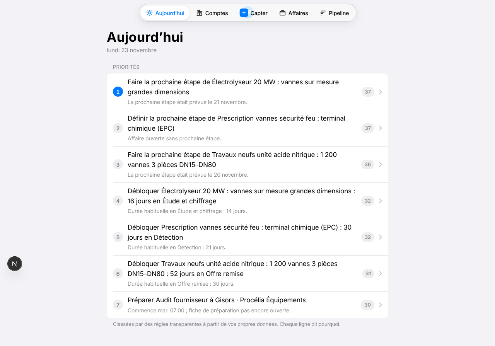
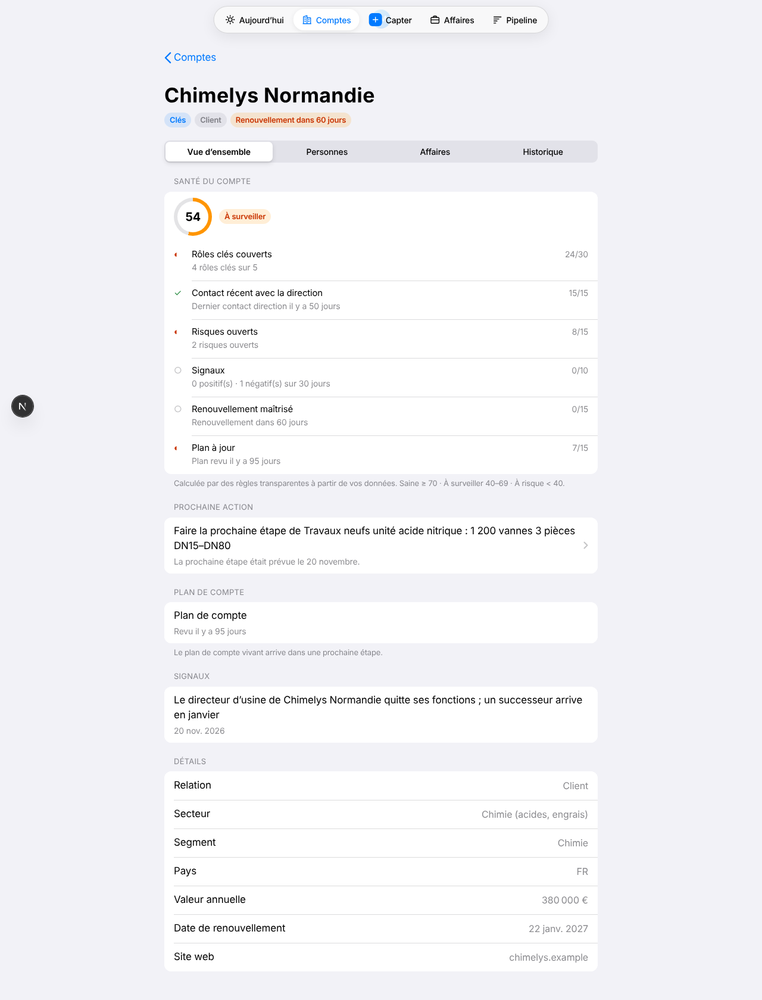

# Cas d’usage : Meca-Inox (fabricant de robinetterie industrielle)

> **Statut :** démonstration. CLEAN reste un produit générique. Ce cas montre
> qu’on peut le configurer, sans code spécifique, pour une PME industrielle réelle
> et publique. **Aucune donnée de Meca-Inox n’est utilisée en dehors de son site
> public.** Tous les clients, contacts, vendeurs, affaires et montants sont
> **inventés** (règle 1 de `CLAUDE.md`). Les clients de référence cités par le site
> ne figurent pas dans le jeu de démo.

## 1. Ce que dit la source publique (vérifiable)

Lu le 23 novembre 2026.

| Fait                                                                                                                                                                              | Source                                                                                           |
| --------------------------------------------------------------------------------------------------------------------------------------------------------------------------------- | ------------------------------------------------------------------------------------------------ |
| Concepteur et fabricant français de vannes à boisseau sphérique en inox depuis 1955                                                                                               | https://meca-inox-valves.com/entreprise/                                                         |
| Siège et usine à Gisors (27) ; direction commerciale Europe à Cergy (95)                                                                                                          | https://meca-inox-valves.com/entreprise/                                                         |
| Plus de 110 personnes en France et plus de 280 dans le groupe ; capacité de 250 000 vannes par an                                                                                 | https://meca-inox-valves.com/entreprise/                                                         |
| ISO 9001 (TÜV) ; 100 % des vannes testées selon EN 12266-1                                                                                                                        | https://meca-inox-valves.com/entreprise/                                                         |
| Rachat de BAC Valves (Espagne, vannes sur mesure de grandes dimensions), 14 avril 2026                                                                                            | https://meca-inox-valves.com/                                                                    |
| Bureaux commerciaux en France, Allemagne, Émirats, Malaisie et Chine ; filiale de distribution au Maroc ; réseau de distributeurs stockistes ; clients OEM et utilisateurs finaux | https://meca-inox-valves.com/entreprise/                                                         |
| Gammes : vannes 3 pièces, 2 pièces à brides DIN, motorisation et accessoires, clapets et voyants, conceptions spéciales                                                           | https://meca-inox-valves.com/                                                                    |
| Marchés : chimie, agroalimentaire, pharma et biotech, gaz industriels, GNL et cryogénie, applications industrielles, nucléaire, hydrogène                                         | https://meca-inox-valves.com/                                                                    |
| Arguments techniques : zéro PFAS, sécurité feu, ATEX, cryogénie jusqu’à −196 °C, vapeur jusqu’à +280 °C, rugosité Ra 0,4 µm ; garantie 3 ans, pièces disponibles 20 ans           | https://meca-inox-valves.com/                                                                    |
| Commandes « de la maintenance (quelques vannes) aux travaux neufs (des milliers) »                                                                                                | https://meca-inox-valves.com/                                                                    |
| SIREN 308 348 499, code NAF 28.14Z (fabrication d’autres articles de robinetterie)                                                                                                | societe.com ; registre officiel : https://annuaire-entreprises.data.gouv.fr/entreprise/308348499 |

## 2. Ce que cela change pour un commercial

| Réalité Meca-Inox                                                                                 | Conséquence pour CLEAN                                                                                                                                   | Où c’est configuré                                |
| ------------------------------------------------------------------------------------------------- | -------------------------------------------------------------------------------------------------------------------------------------------------------- | ------------------------------------------------- |
| Ventes techniques, longues, avec bureau d’études et prescripteurs (ingénieries EPC)               | Étapes industrielles : Détection → Qualification technique → Étude et chiffrage → Offre remise → Négociation et référencement → Commande gagnée / Perdue | `src/domain/profiles.ts` (`industrial_equipment`) |
| Normes et certificats décisifs (DESP, sécurité feu, contact alimentaire, certificats matière 3.1) | Critère « Normes et certifications », **obligatoire en fin de cycle**                                                                                    | idem, `requiredLate`                              |
| Il faut être référencé fournisseur (audit, liste agréée) avant de commander                       | Critère « Référencement fournisseur », obligatoire en fin de cycle                                                                                       | idem                                              |
| La spécification est souvent écrite par un tiers                                                  | Critères « Spécification » et « Prescripteur »                                                                                                           | idem                                              |
| Trois canaux : utilisateurs finaux, OEM, distributeurs stockistes                                 | Segments et secteurs des comptes ; contrats-cadres et commandes de stock comme affaires                                                                  | données du compte                                 |
| Affaires de 30 k€ (maintenance) à plus de 500 k€ (travaux neufs)                                  | Seuil « affaire mono-contact » abaissé à 40 000 €                                                                                                        | `ruleOverrides` du profil                         |
| Cycles longs : un acheteur ou un porteur de budget se voit moins souvent                          | Rythmes de contact : champion 21 j, porteur de budget et décideur 45 j                                                                                   | `cadences` du profil                              |
| Arrêts techniques (intercampagne, maintenance) et appels d’offres                                 | Signaux et événements déclencheurs (« compelling event »)                                                                                                | données des affaires et signaux                   |
| Plans de compte par unité de production                                                           | Plan de compte avec espace blanc par unité × gamme                                                                                                       | `account_plan.whitespace`                         |

Le choix se fait à la création de l’organisation (**Profil de vente** sur l’écran
d’accueil). Il ne fixe que la configuration de départ : étapes, critères, rythmes
et poids restent modifiables (P12 Réglages). Le moteur de règles ne change pas.

## 3. La démo (`pnpm db:seed`)

Organisation **« Meca-Inox (démo) »**, en français, profil `industrial_equipment`
(`src/server/seed/meca-inox-data.ts`). Domaine e-mail inventé `meca-inox.example`.

| Rôle                           | Personne (inventée) | Connexion                           |
| ------------------------------ | ------------------- | ----------------------------------- |
| Commercial grands comptes      | Julien Morel        | `julien.morel@meca-inox.example`    |
| Directeur commercial (manager) | Olivier Garnier     | `olivier.garnier@meca-inox.example` |
| Commerciale (collègue)         | Claire Dumas        | `claire.dumas@meca-inox.example`    |
| Administration des ventes      | Sandrine Lefort     | `sandrine.lefort@meca-inox.example` |

Le portefeuille de Julien : 10 comptes (2 clés), 12 affaires, 40 contacts,
6 mois d’historique, 3 rendez-vous à venir, 5 signaux, 2 plans de compte.

### Les histoires et la règle que chacune déclenche

Chaque ligne est vérifiée par `tests/integration/meca-inox.test.ts`.

| Histoire (inventée)                                                                                                              | Règle « Aujourd’hui »                       |
| -------------------------------------------------------------------------------------------------------------------------------- | ------------------------------------------- |
| Chimelys : offre travaux neufs acide nitrique (420 k€), 52 jours à « Offre remise » pour 30 habituels, revue technique en retard | Affaire bloquée ; prochaine étape en retard |
| Ingéprocess (ingénierie EPC) : prescription sécurité feu, aucune prochaine étape                                                 | Définir la prochaine étape                  |
| Cryonova (OEM GNL) : vannes −196 °C, 340 k€, seul l’acheteur est engagé                                                          | Affaire mono-contact                        |
| Robinetterie Industrielle du Nord (distributeur) : commande de stock dans 15 jours, sans catégorie de prévision                  | Prévision manquante                         |
| Procélia (OEM skids NEP) : référencement fournisseur inconnu en « Étude et chiffrage »                                           | Critère obligatoire inconnu                 |
| Nadia Benkacem, championne chez Chimelys, sans contact depuis 30 jours (rythme 21)                                               | Reprendre contact                           |
| Chimelys : contrat-cadre maintenance renouvelé dans 60 jours, plan revu il y a 95 jours                                          | Renouvellement                              |
| Le directeur d’usine de Chimelys quitte ses fonctions                                                                            | Signal                                      |
| Audit fournisseur à Gisors avec Procélia dans 20 heures                                                                          | Préparer le rendez-vous                     |

Confidentialité : la collègue et l’administratrice ne voient rien du portefeuille
de Julien (testé), comme pour toute organisation.

### Captures (tests de bout en bout)

## 4. Limites et suites

- **Pas de connexion réelle** à l’ERP, à la messagerie ou au CRM de Meca-Inox :
  hors périmètre et soumis à accord (règle « stop and ask »).
- Les pages Affaires (P6), les actions sur Aujourd’hui (P7), la saisie (P8) et le
  plan de compte vivant (P9) arrivent dans les étapes suivantes de la phase 1.
- Pistes propres à l’industrie, non engagées : suivi des appels d’offres par lot,
  canal distributeur (comptes partenaires et revente), base installée et pièces
  détachées, variation du prix de l’inox dans les contrats-cadres.
